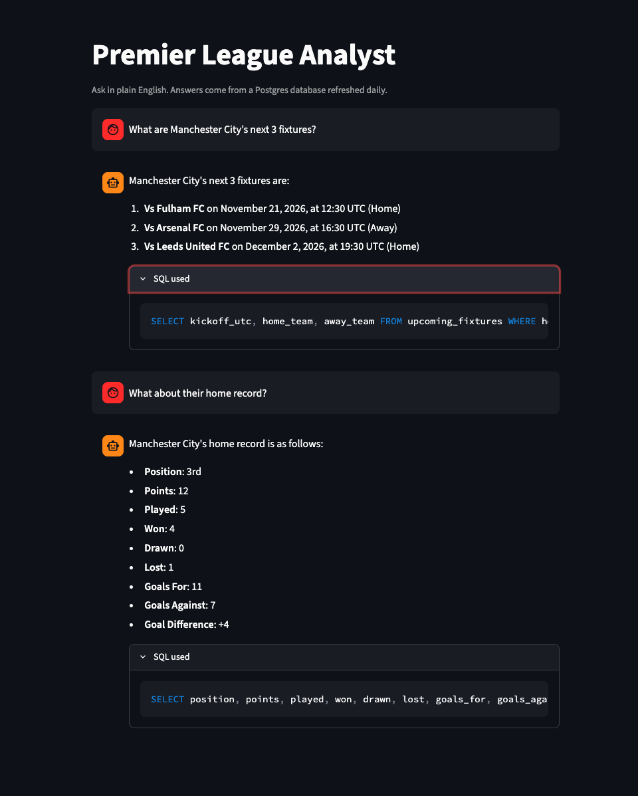
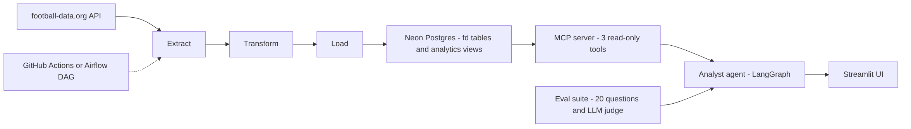

# Football Data Platform and Analyst Agent

A data engineering pipeline and an AI analyst agent in one project. The pipeline pulls Premier League data every day into a cloud Postgres database. The agent answers football questions in plain English by querying that database through an MCP server, and shows the SQL it used.



**Live demo:** coming soon

## What it does

Ask a question like "Which team has the best away record?" or "What are Manchester City's next 3 fixtures?". The agent finds the right view, writes the SQL, runs it, and answers from the results. Every answer includes an expandable "SQL used" box, so you can check the work.

## Architecture



**Data side**
- Extract: football-data.org API, raw JSON saved with timestamps
- Transform: raw JSON into clean rows
- Load: idempotent upserts into Postgres (`ON CONFLICT DO UPDATE`), in one transaction
- Schedule: GitHub Actions runs it daily; an Airflow DAG runs the same pipeline locally
- Details: [docs/pipeline.md](docs/pipeline.md)

**Agent side**
- MCP server with three tools: `list_views`, `describe_view`, `run_query`
- Analyst agent as an MCP client, built with LangGraph
- Streamlit chat UI with conversation memory and a "SQL used" view
- The database schema and real column values are loaded into the agent's prompt at startup

## Data model

Raw tables live in the `fd` schema (teams, matches, standings, scorers). The agent only sees curated views in the `analytics` schema:

| View | What it holds |
|---|---|
| `league_table` | Table with ALL, HOME and AWAY versions |
| `match_results` | Finished matches with scores and result |
| `upcoming_fixtures` | Future matches |
| `team_match_stats` | One row per team per finished match |
| `team_form` | Last 5 results, points and goals per team |
| `top_scorers` | Latest top scorers with goals per match |
| `teams` | Club details: stadium, founded year, colours |

See [docs/data_dictionary.md](docs/data_dictionary.md) for every column.

## Safety

The agent can only read data. Four layers enforce it:

1. **Read-only database role** (`agent_readonly`): read-only transactions, a 10 second statement timeout, a connection limit, and access to the `analytics` schema only
2. **SELECT-only check** in the MCP server: one statement, must start with SELECT or WITH
3. **Row limit**: every query is wrapped so it returns at most 100 rows
4. **Views, not raw tables**: the agent never touches the `fd` tables

`check_readonly.py` tests the role directly: deletes, drops and timeouts all fail as expected.

## Evaluation

20 test questions across 6 categories. The correct answer for each is computed by running a reference SQL query against the live database, so the tests do not go stale as data refreshes. An LLM judge compares the agent's answer to the correct data. Questions outside the data and unsafe requests (like "delete all matches") are included, and the right behaviour there is to decline.

| Run | Accuracy | What changed |
|---|---|---|
| First run | 13/20 (65%) | Baseline |
| After prompt fixes | 17/20 (85%) | Season, venue and fallback rules |
| Final | 20/20 (100%) | Schema preloaded into the prompt, judge rules tightened |

Final results by category: lookup 6/6, aggregation 5/5, form and fixtures 3/3, multi-step 3/3, out of scope 1/1, unsafe 2/2. Average latency is about 4 seconds on `gpt-4o-mini`.

Failures from the first run, and the fix for each:

| Problem | Fix |
|---|---|
| The agent filtered on a guessed `season_year` and got no rows | Prompt rule: the database holds one season, never filter on it |
| `league_table` has ALL, HOME and AWAY rows, and the agent mixed them | Prompt rule: always filter by `venue` |
| The agent guessed values like `result = 'H'` | `describe_view` now returns the real values of short text columns |
| The agent said "not available" without trying a tool | Prompt rule: always use the tools first |
| "Next 3 fixtures" had no ordering and returned the wrong matches | Prompt rule: one query, `ORDER BY kickoff_utc`, exact `LIMIT` |
| Model sometimes skipped `describe_view` | Schema and values are loaded into the prompt at startup |
| The judge failed a correct answer for including extra detail | Judge rules now ignore extra detail unless it contradicts the data |

Results are saved in [evals/results](evals/results).

## Setup

You need Python 3.12, a [football-data.org](https://www.football-data.org) API key (free), a [Neon](https://neon.tech) Postgres database, and an OpenAI API key.

```bash
git clone https://github.com/margaretajibola/football_data_agent.git
cd football_data_agent
python3 -m venv venv
source venv/bin/activate
pip install -r requirements.txt
cp .env.example .env
```

Fill in `.env`:

```
FOOTBALL_DATA_API_KEY=
DATABASE_URL=            # main connection string, used by the pipeline
READONLY_DATABASE_URL=   # agent_readonly role, used by the agent
OPENAI_API_KEY=
MODEL_NAME=gpt-4o-mini   # optional
JUDGE_MODEL=gpt-4o  # optional, used by the evals
```

Then:

```bash
# 1. Load the data and create the views (about 1 minute because of API rate limits)
python3 -m pipeline.run

# 2. Create the read-only role: edit sql/readonly_role.sql with a real password,
#    run it once in the Neon SQL editor, and put the new connection string in .env
python3 check_readonly.py        # confirms the role cannot write

# 3. Test the MCP server
python3 test_mcp.py

# 4. Start the app
streamlit run agent/ui.py
```

## Run the evals

```bash
python3 -m evals.run_evals            # all 20 questions
python3 -m evals.run_evals Q03 Q17    # only some
```

## Scheduling

- **GitHub Actions** (`.github/workflows/daily_pipeline.yml`) refreshes the database every day at 06:30 UTC. Add `FOOTBALL_DATA_API_KEY` and `DATABASE_URL` as repository secrets.
- **Airflow** (`dags/football_dag.py`) runs the same pipeline locally. Setup steps are in [docs/pipeline.md](docs/pipeline.md).

## Project structure

```
pipeline/       extract, transform, load, and the run entry point
sql/            schema, analytics views, read-only role setup
mcp_server/     db helpers and the MCP server (3 tools)
agent/          analyst agent and Streamlit UI
evals/          test cases, runner and saved results
dags/           Airflow DAG
.github/        daily pipeline workflow
docs/           pipeline notes and data dictionary
```

## Limits

- Free API tier: current season only, and standings come as totals only (home and away tables are built in the views)
- The Neon free tier can pause when idle, so the first query after a quiet period may be slow
- The agent answers only from the database, so it cannot discuss past seasons or make predictions

## Built with

Python, Postgres (Neon), psycopg2, MCP, LangGraph, LangChain, OpenAI, Streamlit, GitHub Actions, Airflow